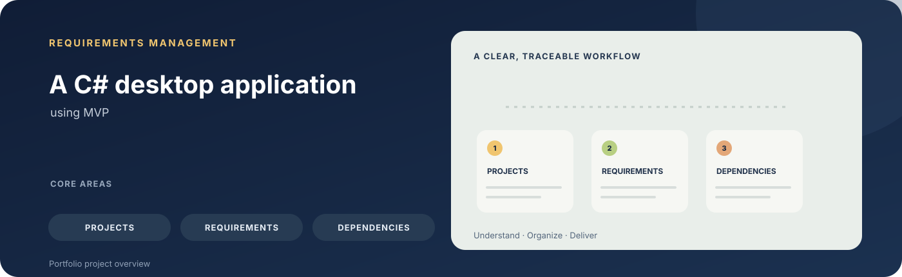

# Requirements Management System

A C# Windows desktop application organized with the Model–View–Presenter (MVP) pattern. The repository separates model, view, presenter, and database-repository code, including interfaces and implementations for users, projects, requirements, and dependencies.

## Project structure

- **Model/** — application data and domain objects.
- **View/** — Windows Forms interface.
- **Presenter/** — coordinates view behavior and application logic.
- **Repo-Database/** — repository interfaces and data-access classes.
- **3.csproj** — Visual Studio project targeting .NET Framework 4.7.2.

## Open and run

Open <code>3.csproj</code> in Visual Studio on Windows, restore the packages listed in <code>packages.config</code>, and build the project. Check <code>App.config</code> and the repository classes for any local database configuration needed in your environment.

## Technology

**C#** · **Windows Forms** · **.NET Framework 4.7.2** · **MVP** · **Repository pattern**

---

*This portfolio entry describes the project structure currently in the repository.*
